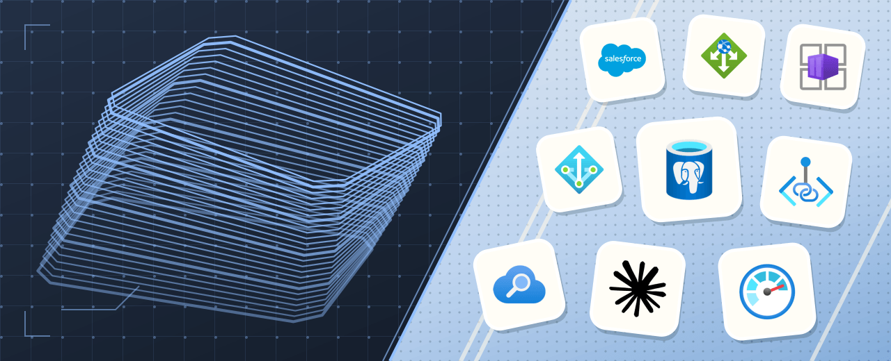
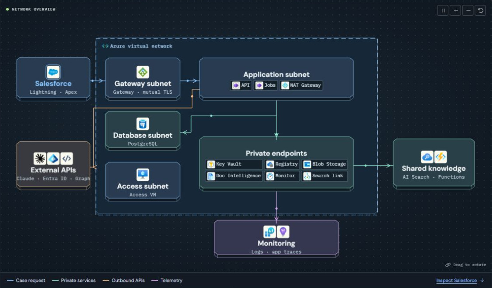

<a href="https://ronybanol-portfolio.vercel.app/">
  <picture>
    <source media="(max-width: 600px) and (prefers-reduced-motion: no-preference)" srcset="https://raw.githubusercontent.com/Rony-San/Rony-San/main/assets/signal-mobile.gif">
    <source media="(max-width: 600px)" srcset="https://raw.githubusercontent.com/Rony-San/Rony-San/main/assets/signal-mobile-still.png">
    <source media="(prefers-reduced-motion: no-preference)" srcset="https://raw.githubusercontent.com/Rony-San/Rony-San/main/assets/signal.gif">
    
  </picture>
</a>

I’m a systems engineer and full-stack developer. I build voice agents, visual workflow editors, and integrations that connect Salesforce to services on Microsoft Azure.

**[Explore the projects in 3D →](https://ronybanol-portfolio.vercel.app/#projects)** · [Browse my public repositories](https://github.com/Rony-San?tab=repositories) · [Email me](mailto:ronysantiagoba@gmail.com)

## Selected projects

### Salesforce Agent Integration with Microsoft Azure

A support representative can reconstruct a case timeline or prepare a handoff from Salesforce. Apex sends the request through mutual TLS to an Azure gateway. A FastAPI service retrieves evidence over private endpoints and reaches external APIs through NAT. [Explore the interactive network →](https://ronybanol-portfolio.vercel.app/projects/salesforce-agent-integration/#network-overview)

  
Preview the network and its technology stack

- **Application and identity** · Salesforce Lightning and Apex, FastAPI, Azure Container Apps and jobs, Container Registry, Microsoft Entra ID, Microsoft Graph, and Anthropic Claude.
- **Network and data** · Azure Virtual Network, Application Gateway, NAT Gateway, Private Link, private endpoints, Azure Virtual Machines, PostgreSQL, Key Vault, Blob Storage, and Document Intelligence.
- **Search and telemetry** · Azure AI Search, Azure Functions, Azure Monitor Private Link Scope, Log Analytics, and Application Insights.

### Visual Agent Workflow Builder

A builder describes a task, edits the proposed flow in a browser canvas, and publishes it. Attached documents provide context, and PostgreSQL stores each flow with its runs. [Follow a brief through the builder →](https://ronybanol-portfolio.vercel.app/projects/visual-agent-workflow-builder/)

**Tools** · Next.js, FastAPI, Azure OpenAI, Azure Database for PostgreSQL, Azure Blob Storage, Azure AI Document Intelligence, Azure Container Apps, Azure Key Vault, Azure Container Registry, Log Analytics.

### Adaptive Voice Interview

A participant answers by voice or text. A state machine extracts structured fields and uses the answer to choose the next interview question. [Follow an interview turn →](https://ronybanol-portfolio.vercel.app/projects/fsm-agent/)

**Tools** · Next.js, FastAPI, Azure AI Speech, Azure OpenAI, Azure Container Apps, Azure Container Registry, Azure Blob Storage.

### Voice Agent Practice Rooms

A guest joins a voice room through a shared link. The session API saves captions in Blob Storage, then uses Azure OpenAI to generate feedback for the team. [Trace a guest session →](https://ronybanol-portfolio.vercel.app/projects/voice-agent-practice-rooms/)

**Tools** · Next.js, FastAPI, Cloudflare Turnstile, Azure Blob Storage, Azure OpenAI, Stripe, TypeScript, Python.

### Workplace Incident Reporting

A reporter can dictate a workplace incident in Power Apps, review the details, and save the report to SharePoint. Power Automate provisions the lists behind the form. [Trace an incident report →](https://ronybanol-portfolio.vercel.app/projects/wpv/)

**Tools** · Power Apps, SharePoint, Power Automate, TypeScript.

### Document Approval Assistant

A signed-in user asks a question about a reference document, reviews a proposed action, and confirms it before the assistant starts an approval workflow. [Follow an approval request →](https://ronybanol-portfolio.vercel.app/projects/document-approval-assistant/)

**Tools** · React, FastAPI, Microsoft Entra ID, Azure OpenAI, Azure AI Document Intelligence, Power Automate, Docker, Python.

### Meeting Transcription Assistant

Participants meet in a WebRTC room with live captions. After the call, the service produces a summary and keeps it alongside the transcript in the meeting record. [Follow a meeting from audio to summary →](https://ronybanol-portfolio.vercel.app/projects/meeting-transcription-assistant/)

**Tools** · Next.js, FastAPI, Cloudflare Realtime, Azure OpenAI, Azure Database for PostgreSQL, Azure App Service, Azure Container Registry, Azure Blob Storage, Azure Key Vault.

### Interview Analysis Workspace

A team chooses a question to investigate across interviews. Queue workers process each transcript, then combine the findings into a report the team can trace back to the evidence. [Trace the interview analysis queue →](https://ronybanol-portfolio.vercel.app/projects/interview-analysis-workspace/)

**Tools** · Next.js, FastAPI, Azure Queue Storage, Azure Functions, Azure OpenAI, Azure Database for PostgreSQL, Azure Container Apps, Azure Blob Storage, Azure Key Vault, Azure Container Registry, Application Insights.

### Coaching Subscription Platform

A participant accepts an invitation, checks out through Stripe, and follows a coaching plan. Coaches use completed activities and check-ins to review progress. [Follow enrollment to a check-in →](https://ronybanol-portfolio.vercel.app/projects/coaching-subscription-platform/)

**Tools** · Next.js, FastAPI, Stripe, Azure App Service, Azure Database for PostgreSQL, Azure Functions, Azure Key Vault, Azure Container Registry, Application Insights.

## Public code

- **[Role-based task manager](https://github.com/Rony-San/Rony-Banol-Gestion-de-tareas)** — A Next.js application for managing projects and tasks, with separate administrator and user workflows.
- **[Distributed word count](https://github.com/Rony-San/Final-Project-Operating-Systems)** — A team-built Python MapReduce project that distributes word counting across machines and records each node’s execution time.

## Tools and collaboration

I work with **TypeScript, React, Next.js, Python, FastAPI, PostgreSQL, and Azure**. I’m currently learning **Bicep and Terraform**, and I’m open to collaborating on full-stack web development and resilient cloud architecture.

  
More of my toolkit

- **Web and mobile** — JavaScript, CSS, Tailwind CSS, and React Native.
- **Services and APIs** — Node.js, Express, Flask, Java, Spring, Ruby on Rails, GraphQL, and Postman.
- **Cloud and infrastructure** — AWS, Google Cloud, Docker, Kubernetes, Linux, and Git.
- **Storage** — MongoDB, MySQL, and Firebase.

  
GitHub activity and public repository languages

  
  

