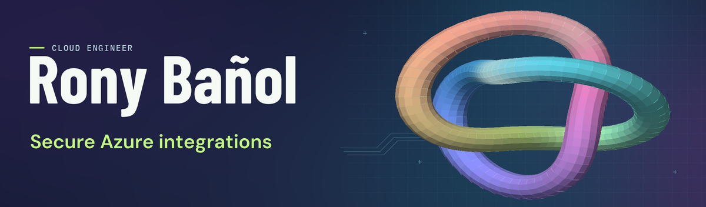
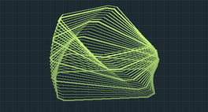

<a href="https://ronybanol-portfolio.vercel.app/">
  <picture>
    <source media="(max-width: 600px) and (prefers-reduced-motion: no-preference)" srcset="https://raw.githubusercontent.com/Rony-San/Rony-San/main/assets/signal-mobile.gif">
    <source media="(max-width: 600px)" srcset="https://raw.githubusercontent.com/Rony-San/Rony-San/main/assets/signal-mobile-still.png">
    <source media="(prefers-reduced-motion: no-preference)" srcset="https://raw.githubusercontent.com/Rony-San/Rony-San/main/assets/signal.gif">
    
  </picture>
</a>

I’m a systems engineer and full-stack developer. I build voice agents, visual workflow editors, and assistants that route requests for approval. My current project is [Huddle Horizon](https://www.huddlehorizon.com/).

**[Explore the projects in 3D →](https://ronybanol-portfolio.vercel.app/#projects)** · [Browse my public repositories](https://github.com/Rony-San?tab=repositories) · [Email me](mailto:ronysantiagoba@gmail.com)

## Selected projects

### Huddle Horizon

  
  A guest joins a voice-agent room. The session API saves the captions in Azure Blob Storage and uses Azure OpenAI to generate feedback. 
  <a href="https://ronybanol-portfolio.vercel.app/projects/huddle-horizon/">Trace a voice session →</a>

### Agentic Platform Trust

  
  A builder describes a task in plain language, edits the proposed flow in a Next.js canvas, and publishes it. FastAPI coordinates generation and stores the flow in PostgreSQL. 
  <a href="https://ronybanol-portfolio.vercel.app/projects/agentic-platform-trust/">Follow a brief through the builder →</a>

## Public code

- **[Role-based task manager](https://github.com/Rony-San/Rony-Banol-Gestion-de-tareas)** — A Next.js application for managing projects and tasks, with separate administrator and user workflows.
- **[Distributed word count](https://github.com/Rony-San/Final-Project-Operating-Systems)** — A team-built Python MapReduce project that distributes word counting across machines and records each node’s execution time.

## Tools and collaboration

I work with **TypeScript, React, Next.js, Python, FastAPI, PostgreSQL, and Azure**. I’m currently learning **Bicep and Terraform**, and I’m open to collaborating on full-stack web development and resilient cloud architecture.

  
More of my toolkit

- **Web and mobile** — JavaScript, CSS, Tailwind CSS, and React Native.
- **Services and APIs** — Node.js, Express, Flask, Java, Spring, Ruby on Rails, GraphQL, and Postman.
- **Cloud and infrastructure** — AWS, Google Cloud, Docker, Kubernetes, Linux, and Git.
- **Storage** — MongoDB, MySQL, and Firebase.

  
GitHub activity and public repository languages

  
  

